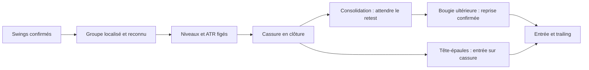

# Groupes temporels de swings : prototype supports/résistances

Le mode expérimental `--strategy swing-patterns` détecte une **figure entière**, puis suit son évolution. Il est indépendant de `structure` et de `swing-regression` : les réglages de l’hybride sélectif restent ceux de ce moteur.

## Ce qui change

L’ancien détecteur de tête-épaules utilisait déjà la symétrie des deux demi-figures dans son score. Il ne bornait pas toute leur durée ni chaque intervalle entre pivots. Les niveaux historiques étaient principalement regroupés par proximité de prix. Le retest pouvait être reconnu sur la même bougie que la cassure.

Le nouveau moteur utilise deux coordonnées par swing : **le moment de l’extrême** et **le moment où le retournement devient connu**. Les sommets viennent du bid, les creux de l’ask. Une paire de bougies opposées doit être clôturée avant que son swing soit disponible.

Les petits contre-mouvements inférieurs à 0,5 ATR sont absorbés avant la recherche des figures. Ce filtrage définit une échelle structurelle unique ; le détecteur prend ensuite des swings adjacents à cette échelle, sans chercher des combinaisons arbitraires parmi les anciens pivots. Si un extrême est remplacé, sa nouvelle date de confirmation est conservée.

Chaque groupe doit respecter :

- une durée de 6 à 48 périodes, mesurée en temps écoulé ;
- un écart maximal de 12 périodes entre deux extrêmes successifs ;
- des pivots alternés, ordonnés et déjà confirmés ;
- un mouvement préalable cohérent, observé sur les deux swings précédant le groupe ;
- une géométrie et une amplitude suffisantes par rapport à l’ATR.

Sur H1, 48 périodes signifient 48 heures écoulées. Les longues interruptions de cotation séparent les groupes ; les week-ends ne sont pas comprimés en quelques indices de bougies. Une bougie finale incomplète ou libérée trop tard après une interruption ne déclenche pas d’entrée.

## Deux familles d’entrées

| Figure | Groupe | Confirmation | Invalidation initiale |
|---|---|---|---|
| Tête-épaules | Sommet, creux, tête, creux, sommet, après une progression | Cassure baissière nette de la ligne de cou | Épaule droite + marge ATR |
| Tête-épaules inversée | Symétrique, après une baisse | Cassure haussière nette de la ligne de cou | Épaule droite − marge ATR |
| Continuation après consolidation | 4, 6 ou 8 swings, au moins deux contacts sur chaque bord | Cassure dans le sens du mouvement préalable, retour au niveau, puis reprise sur une bougie ultérieure | Extrême du retest ± marge ATR |

Pour la tête-épaules, l’écart de hauteur des épaules et des deux points de cou est borné. La tête doit dépasser les épaules d’au moins 0,6 ATR ; le rapport de durée des deux demi-figures doit rester inférieur ou égal à 2,5. La ligne de cou peut être inclinée.

La continuation de cette première version est une **consolidation rectangulaire**. Les contacts d’un même bord doivent tenir dans 0,35 ATR. Ce moteur n’inclut pas encore les triangles ou les drapeaux inclinés.



Un groupe reconnu est conservé même si de petits swings supplémentaires se forment avant sa cassure. Il expire après six périodes depuis sa dernière confirmation. Une première cassure trop faible, une extension excessive ou une invalidation consomme le groupe : une bougie plus tardive ne peut pas le recycler.

Pour le retest : retour sous six périodes après la cassure, profondeur maximale de 0,5 ATR, puis reprise du haut/bas de la **première bougie de contact** sous trois périodes. Cette échéance ne glisse pas à chaque nouveau contact. La cassure, le contact et la confirmation sont des bougies distinctes.

Les bougies de confirmation doivent avoir un corps directionnel d’au moins 35 % et une clôture située dans les 35 % favorables de leur amplitude. La distance restante jusqu’à l’objectif mesuré doit représenter au moins 1 R. Cet objectif sert à évaluer l’espace disponible ; avec `--trailing-stop`, il ne devient pas un TP fixe. Les bornes d’entrée conservent ces contraintes si le prix change avant la soumission. Le stop est explicite et le moteur standard conserve la gestion du risque, de l’exécution et du trailing.

Une seule position ou un seul ordre en attente est autorisé par symbole par cette stratégie. Le contexte du signal contient les swings, leurs deux dates, la durée du groupe, les dates des étapes, le niveau figé, l’ATR et l’espace disponible. Les diagnostics distinguent notamment groupes reconnus, expirations, cassures faibles, invalidations, retests et confirmations.

## Exécution

Depuis `C:\Users\Babs\workspace\TradingBot` :

```powershell
py -m ultimateBot.run_backtest --strategy swing-patterns --symbols EURUSD GBPUSD USDCAD USDCHF --start-date 2024-01-01 --end-date 2025-12-31 --candle-interval 60m --reward-risk-ratio 2.3 --risk-percent 1 --trailing-stop --trailing-start-rr-ratio 1
```

Choisir une famille avec `--pattern-family head-shoulders` ou `--pattern-family continuation`. Pour imposer aussi un retest après la ligne de cou : `--pattern-head-shoulders-entry retest`.

Les paramètres sont regroupés dans `TemporalPatternConfig`, dans `backtester/strategy/temporal_patterns.py`, et exposés par les options `--pattern-*`. Par exemple : `--pattern-max-span-bars 48`, `--pattern-max-swing-gap-bars 12`, `--pattern-min-swing-leg-atr 0.5`. `--level-lookback-bars` règle la capacité d’historique, indépendamment de la durée maximale d’une figure. Le minimum technique est 14 bougies, le défaut est 76. Les optimisateurs adaptatifs sont refusés pour cette expérience à paramètres fixes.

## Premier constat sur les données locales

Le balayage causal de 2024–2025 porte sur environ 49 900 bougies H1 réelles des quatre paires. Il détecte **quatre confirmations brutes**, toutes sur EURUSD : trois têtes-épaules baissières et un retest de consolidation. Il reste donc **beaucoup trop sélectif pour multiplier les opportunités**. Cela valide une première chaîne de détection, sans démontrer de rentabilité ou de complémentarité avec l’hybride.

Les résultats détaillés sont dans `artifacts/temporal_pattern_groups/summary.json` et `signals.json`. Le balayage est toujours à plat et ne simule ni les exécutions ni les résultats financiers : les confirmations ne sont pas un bilan de trades. Les essais de mise au point restent dans les répertoires `temporal_patterns`, `temporal_patterns_structural` et `temporal_patterns_frozen` ; ils ne constituent pas une optimisation sur le PnL.

Un contrôle avec le moteur standard et tous les ticks EURUSD du 22 au 31 décembre 2025 retrouve la confirmation de consolidation le 31 décembre à 05:00:00.889 UTC. L’ordre est exécuté à 05:00:04.091, puis fermé à l’équilibre par le trailing à 09:27:10.313. Le stop structurel est 1,1745965 et le prix d’entrée 1,17343. Aucun ordre ni position ne reste ouvert à la fin de ce contrôle. Log : `artifacts/temporal_patterns_tick_control.log`.

Un second contrôle sur tous les ticks EURUSD du 4 au 11 février 2025 retrouve la tête-épaules du 10 février à 19:00:00.352 UTC. Le trade est exécuté à 1,03068, puis stoppé le lendemain à 1,03288 : **−1,02 %** du capital initial, avec le risque demandé de 1 %. Il ne reste aucun ordre ni position. Ce contrôle vérifie l’exécution du nouveau type d’entrée ; son résultat ne démontre aucun avantage financier. Log : `artifacts/temporal_patterns_head_shoulders_control.log`.

Validation automatisée : 24 tests propres aux groupes temporels, et 205 tests ciblés au total avec les entrées de régression, la configuration, le risque, les ordres et le trailing. Les tests couvrent les figures symétriques achat/vente, les bornes temporelles, le filtrage des petits swings, la persistance des groupes, la consommation des cassures faibles, les échéances fixes, les bougies incomplètes et la compatibilité CLI.

Pour refaire uniquement le repérage :

```powershell
py -m ultimateBot.audit_temporal_patterns --start-date 2024-01-01 --end-date 2025-12-31 --output ultimateBot/artifacts/temporal_pattern_groups
```

La suite de recherche devrait examiner les rejets par étape et les figures concrètes, puis tester des consolidations inclinées ou une autre échelle de swings sur une période distincte. Une fusion avec les entrées de régression demanderait ensuite un rejeu du portefeuille commun, pour mesurer les entrées réellement ajoutées et les trades existants éventuellement déplacés.
